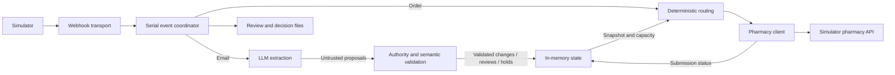

# Pharmacy Desk Architecture

This document describes the implemented core and the decisions behind it. Requirements come from the [challenge](docs/challenge.md) and [simulator contract](sim/README.md); conflict resolution and uncertainty handling below are implementation choices. Setup and results are in the [README](README.md).

## Business model and invariants

Sam's task has three distinct concerns: maintain pharmacy facts, apply authorized ops preferences, and route orders against the state known at arrival. Emails propose changes; they do not authorize themselves. The LLM interprets language; code controls authority, state, and submission.

The core must process the week, submit each order to one pharmacy or `MANUAL`, and explain uncertain emails and routing decisions. Its invariants are:

- Safety constraints always precede ops preferences, speed, and price.
- Availability means the exact medication and dose; `25mg` is never guessed to mean `2.5mg`.
- Duplicate events/orders never repeat changes, submissions, or capacity accounting.
- Future changes and later knowledge cannot alter earlier decisions.
- Uncertain external submissions remain explicit failures; they are not disguised as `MANUAL`.

## Architecture and ownership

A single Node.js process serializes events. TypeScript and Zod provide static and runtime contracts; Express handles transport; `node:test` verifies behavior. In-memory baseline plus validated change records supports temporal snapshots without a database, queue, or general event-sourcing framework.

| Module | Owns | Boundary |
| --- | --- | --- |
| `server.ts` | JSON parsing, routes, HTTP responses | No email interpretation or routing |
| `desk.ts` | Serialization, initialization, deduplication, workflow | Delegates domain checks and selection |
| `email.ts`, `model-schema.ts` | Model requests, retries, extraction decoding | No tools, state writes, or submission authority |
| `changes.ts` | Sender scope, catalogue, evidence, time, corrections | Produces validated groups or review results |
| `store.ts` | Baseline, changes, snapshots, holds, capacity, submissions | State mutation boundary; no network calls |
| `routing.ts` | Eligibility, preference, ranking, explanation | Pure function; does not reserve or submit |
| `pharmacy.ts` | One submission and response classification | Never retries or changes the destination |
| `audit.ts` | Review snapshots and append-only diagnostic/decision logs | Files are evidence, not restart recovery |
| `contracts.ts`, `normalize.ts`, `time.ts` | Schemas, canonical values, temporal conventions | No orchestration |

## Data and API contracts

### Webhook input

`POST /webhooks` accepts JSON up to 256 KB. Every event has `event_id`, `type`, and an offset-bearing ISO `occurred_at`. Optional `x-event-id` and `x-sim-time` headers must match the body.

| Type | Payload | Meaning |
| --- | --- | --- |
| `simulation.started` | `pharmacyApi`, `config: { catalogue, lumimedsOps, pharmacies }` | Initialize the baseline and remote API address |
| `email` | `email: { from, subject, body }` | Propose timed fact or preference changes |
| `order` | `order: { order_id, state, medication, dose }` | Select and submit using the current snapshot |

Each pharmacy supplies `id`, `name`, `contacts`, `open`, `shipsInDays`, `dailyCapacity`, `price`, `blockedStates`, and `stock`. `catalogue` and `stock` map medication names to dose arrays; stock is availability, not quantity. Prices are USD per medication. Capacity is a nonnegative integer shared across medications; prices and shipping times are finite, nonnegative numbers. IDs and normalized contact ownership must be unique; stock must belong to the catalogue.

Email addresses are trimmed and lowercased before exact matching. State names and postal codes normalize to one value (`Texas` → `TX`), then restrictions are evaluated per pharmacy. Equivalent dose formatting is normalized; unknown doses are not repaired. Runtime schemas are defined in [contracts.ts](src/contracts.ts); full protocol examples are in [sim/README.md](sim/README.md).

| HTTP response | Meaning |
| --- | --- |
| `200 { status: "processed" }` | Event completed; an order has a confirmed submission |
| `200 { status: "duplicate" }` | Previously completed event; no repeated side effects |
| `400` / `413` | Invalid JSON/schema/headers or oversized body |
| `409` | Not initialized, conflicting identity/content, or a new event moving time backward |
| `502` | Pharmacy submission rejected or unknown |
| `500` | Internal or audit-write failure |

Errors use `{ error: string }`. A review item completes email processing successfully. A structurally valid order with an unknown state, medication, or dose goes to `MANUAL`; a missing order ID is a `400`. `GET /health` returns `{ status: "ok", initialized: boolean }`.

### Model extraction

The model receives the email, event time, catalogue, pharmacy identities, relevant prior changes, and unresolved reviews. Email text is untrusted data. Native Anthropic structured output constrains the response; local validation remains authoritative.

| Field | Contract |
| --- | --- |
| `groups[]` | Independently validated business groups |
| `changes[]` | Dependent operations applied atomically within one group |
| `issues[]` | `code`, `detail`, safety relevance (`possible` / `none`), optional affected scope |
| `resolvesReviewIds[]` | Proposed review resolutions; code checks authority, evidence, and complete scope |
| Common change fields | `pharmacyId`, `effectiveFrom`, nullable `effectiveUntil`, `evidence`, nullable `timeText`, `supersedes[]` |

| Operation | Operation-specific fields |
| --- | --- |
| `stock.set` | `medication`, `dose`, `available` |
| `state.set` | `state`, `blocked` |
| `open.set` | `open` |
| `capacity.set` | `dailyCapacity` |
| `shipping.set` | `shipsInDays` |
| `price.set` | `medication`, `usd` |
| `routing.prefer` | `match: { medication?, dose?, state? }`; empty means all orders |

The provider wire format nests the operation and its fields in `action`, leaving common fields outside the union. [model-schema.ts](src/model-schema.ts) validates and flattens it into the canonical change contract. This reduces compiled grammar size without removing local business constraints.

Code verifies sender authority, catalogue membership, evidence, supported time semantics, conflicts, and correction references. Accepted changes receive code-generated `changeId`, `sourceEventId`, `receivedAt`, and `sequence`. The model cannot assign trust or mutate state. Schema conformance and quoted evidence do not prove semantic correctness or completeness.

### Submission and stored records

The client calls `POST {pharmacyApi}/pharmacy-orders` with `{ order_id, pharmacy, reason }`; the destination is a configured ID or `MANUAL`. The API address comes from initialization. A webhook response does not replace this call.

The store retains validated changes with provenance, reviews with original emails and optional holds, capacity by Eastern date/pharmacy, event fingerprints, and order submissions. Decisions record `orderId`, `eventTime`, `candidates`, `exclusions`, `appliedChangeIds`, `selected`, and `reason`. Submissions record the order fingerprint, target, date, status, and response code. These records support explanation and in-process deduplication, not durable recovery.

## Business decisions and uncertainty

1. Exclude pharmacies that are closed, block the state, lack the exact dose, have exhausted capacity, lack a medication price, or have a relevant unresolved safety hold.
2. Apply the latest received, active ops preference matching the order, if its target is eligible.
3. Otherwise rank all eligible pharmacies by `shipsInDays`, medication price, then pharmacy ID. An unsafe latest ops target does not revive an overridden older preference.
4. Submit `MANUAL` only when there is no safely eligible candidate. Record exclusions and any ops fallback.

| Situation | Policy |
| --- | --- |
| Configured pharmacy contact | May change its own facts and prices; cannot direct platform routing |
| Configured ops contact | May set routing preferences and explicit pharmacy facts |
| Unknown sender or unauthorized operation | Review; no fact mutation or hold solely for being unauthorized |
| Mixed valid and invalid email content | Validate independent groups separately; dependent corrections stay atomic |
| Trusted, unclear closure/stock/state/capacity | Review and hold the identifiable affected scope and interval |
| Unclear price, delivery speed, or preference | Review without a safety hold |
| Extraction completely fails for a trusted sender | Hold its pharmacy, or potentially all pharmacies for ops, when scope cannot be established |

Independent, credible restrictions in a rejected dependent group are preserved as safety uncertainty, not accepted facts. Holds expire at a known end or require validated clarification covering the whole scope. A stock update cannot clear a broad unknown-state hold. Whole-pharmacy extraction-failure holds require investigation; this version has no manual approval interface. Stable review reasons include `UNAUTHORIZED`, `INVALID_DOSE`, `AMBIGUOUS_TIME`, `CONFLICT`, and `LLM_FAILURE`.

## Time, capacity, and delivery reliability

| Concern | Decision |
| --- | --- |
| Business clock | `occurred_at` only; wall time is used for request budgets and diagnostics |
| Local dates | `America/New_York`, including DST; daily capacity is confirmed plus reserved orders |
| Effective intervals | `[from, until)`; null end means indefinite; future changes activate through snapshot evaluation |
| Relative phrases | Anchored to email time; “tomorrow” starts next local midnight; unsupported expressions go to review |
| End-date convention | “Until/back on Wednesday” ends Wednesday 00:00; “through Wednesday” ends Thursday 00:00; “rest of week” ends next Monday |
| Overlapping changes | Latest received active value wins; expiry reveals an earlier active value or baseline |
| Corrections/history | Authorized, exact change references; withdraw future effects from correction receipt, never rewrite earlier decisions |
| Snapshot visibility | Requires both effective time and receipt order; backdated messages cannot introduce knowledge into past snapshots |
| Event deduplication | Check ID and fingerprint before chronological validation; identical redelivery never rewinds time |
| Order deduplication | Same ID/content reuses the recorded outcome; changed content conflicts; failed/unknown submissions are not resent |

An order's destination and capacity reservation are recorded before network submission. A `201` confirms the order and converts its reservation to confirmed usage; `MANUAL` consumes no pharmacy capacity. `400`/`404` reject and release the reservation. `409`, other unexpected responses, timeouts, or disconnects mean **unknown**: retain the reservation, return `502`, and neither retry nor reroute. Other orders continue with conservative capacity accounting. An audit failure after submission must not cause a resend.

Model extraction allows at most two attempts within 20 seconds; permanent API errors stop immediately. The event processing budget is 25 seconds, below the simulator's default 30-second wait; cancelled model results cannot mutate state later. A separate preflight allows 60 seconds for cold schema compilation before replay starts.

Initialization redelivery is idempotent; a different start resets state. The protocol has no run ID, so an identical new replay cannot be distinguished from redelivery: restart the service for each manual replay. With in-memory state and no remote status query, exactly-once submission across crashes or ambiguous failures is not guaranteed.

## AI-assisted design review

AI assisted requirement analysis, architecture review, implementation, and tests. The workflow was **draft → challenge assumptions → encode invariants → test → inspect real replay evidence**. The following decisions show how proposals were evaluated rather than accepted as authority.

| Proposal or finding | Review and resulting decision |
| --- | --- |
| Reject an entire email atomically if any content fails validation | Rejected: an unrelated unauthorized instruction could erase a valid closure. Independent groups are validated separately; dependent corrections remain atomic. Regression tests cover both boundaries. |
| Let the model interpret email changes | Kept extraction separate from authorization and routing. Code checks identity, scope, catalogue, evidence, and time; the model has no execution tools. |
| A locally valid JSON Schema should work with the provider | Real integration exposed unsupported schema combinations and excessive grammar complexity. Common fields were factored out of operation branches, decoding retained canonical validation, and a real API preflight was added. |
| A clean simulator exit is sufficient acceptance evidence | Rejected: complete delivery can still contain wrong destinations. Replay compares all orders against independently labeled expectations and preserves failed reports and model diagnostics. |

Verification separates deterministic behavior from model variability: 64 automated tests cover domain rules, change validation, adapters, HTTP handling, and report integrity; three real model-backed public-week replays each matched all 38 destinations across 52 deliveries. Labels are test-only, never routing logic. See [recorded evidence](docs/verification.json) and [commands/artifacts](README.md#verify).

## Scope and remaining risks

The implemented scope is the routing service, review list, and audit trail. A UI, approval workflow, reply generation, model comparison, and restart recovery were deferred to prioritize the core. Allowing ops to maintain explicit facts, preference fallback, override restoration, and date-phrase conventions are documented choices, not prescribed algorithms from the challenge.

Model omissions and semantic mistakes remain possible; public-week success does not establish unseen-week accuracy. Sender addresses provide simulator authority, not production authentication. Production work would add durable state, authenticated input, remote idempotency/status reconciliation, operator approval, and monitoring. Logs support investigation but do not restore state.
